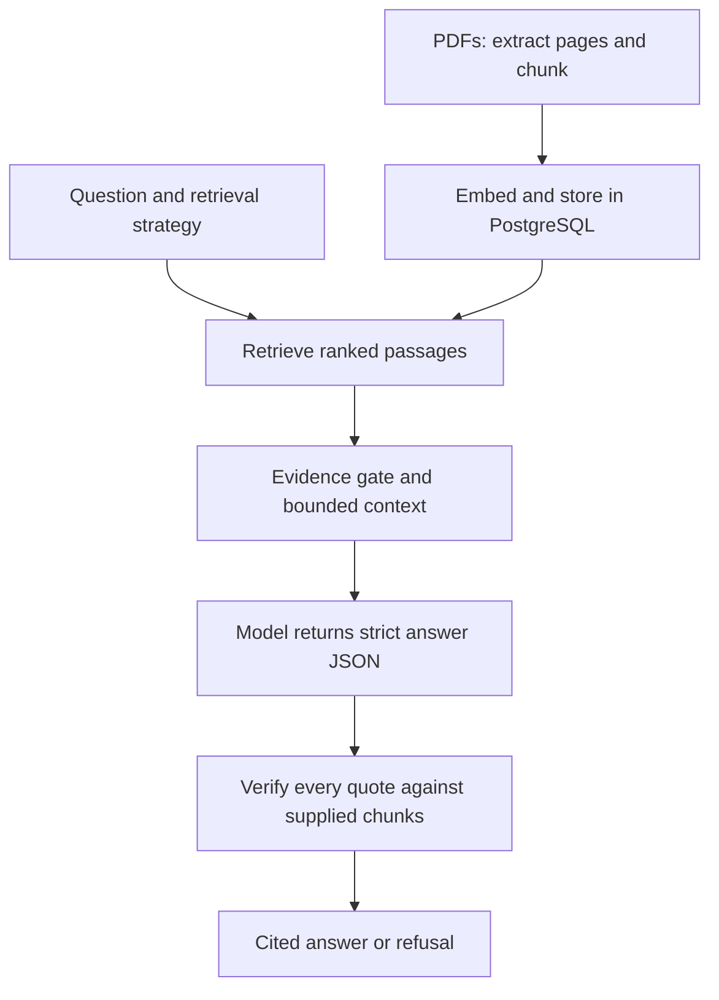

# CiteRAG

Ask questions over two public NIST AI risk-management PDFs and receive answers
with a document, physical PDF page, and verified quoted passage. Weak evidence,
unsupported model responses, or invalid citations produce a refusal. Provider
failures produce clear errors. M1–M4 are implemented, tested, and measured.

[Architecture](docs/architecture.md) · [Operate and deploy](docs/operations.md) ·
[Evaluation](eval/README.md) · [Answer key](eval/golden-review.md) ·
[Learn RAG](docs/learning-guide.md) · [Change history](CHANGELOG.md)


This original model capture is retained with its observed wording issue:
“should” became “must.” The current prompt asks for source obligation/uncertainty clauses to be copied;
the [focused check](eval/results/20261027_wording-check.md) preserved q01
wording in vector and hybrid. A prompt rule is not a semantic guarantee.

## Run locally

Prerequisites: Git and Docker Compose v2.

```bash
git clone https://github.com/garvj65/cite-rag.git
cd cite-rag
cp .env.example .env
docker compose up --build --wait frontend
```

Open <http://localhost:8080>; the API and interactive `/docs` are at
<http://localhost:8000>. These four commands start the UI, API, and PostgreSQL 16
with pgvector and apply migrations. The index starts empty; real providers are
disabled until explicitly enabled.

Download the [two approved PDFs](docs/corpus-reference.md) (112 physical pages):

```bash
docker compose run --rm --user root --volume ./corpus:/app/corpus backend python scripts/download_corpus.py
```

Edit the untracked `.env` locally, keeping the key out of Git and chat:

```dotenv
ENABLE_REAL_PROVIDERS=true
EMBEDDING_PROVIDER=gemini
LLM_PROVIDER=gemini
GEMINI_API_KEY=your-local-key
GEMINI_CHAT_MODEL=gemini-3.5-flash-lite
GEMINI_EMBEDDING_MODEL=gemini-embedding-2
SEARCH_STRATEGY=vector
```

Then index once:

```bash
docker compose up --wait backend
docker compose exec backend python -m app.ingest --path corpus/
```

Ingestion reports progress and JSON counts/reasons. Identical PDF bytes and index
settings are skipped, including renamed files. PDFs and secrets are gitignored.
For a keyless mechanics demo explicitly choose `EMBEDDING_PROVIDER=fake`,
`LLM_PROVIDER=fake`, and `ENABLE_REAL_PROVIDERS=false`, then ingest that profile.
The fake LLM refuses by default; fake scores are not semantic-quality evidence.
OpenAI remains an explicit alternative behind the same provider interfaces.
No paid, fake, or alternate-model fallback occurs automatically.

## How it works



- Python 3.12, FastAPI, Pydantic v2, SQLAlchemy 2, Alembic, PostgreSQL 16/pgvector;
  React, TypeScript, and Vite. Dependencies are locked with uv and npm.
- Page-bound 400-word windows overlap by 80 words, preserving document hash,
  physical page, chunk index, and text offsets. Each index profile isolates its
  model, dimensions, and chunk settings. Writes are atomic and idempotent.
- Vector uses exact cosine search; keyword uses PostgreSQL English full-text
  search; hybrid uses Reciprocal Rank Fusion. RRF orders passages; original
  cosine/FTS component scores determine answer eligibility.
- Numbered passages are untrusted JSON data. The model must return
  `{answer, citations:[{doc_id,page,quote}], supported}`. Strict validation and
  whitespace-normalized quote checks reject malformed or fabricated citations.
  Any invalid citation withholds the entire answer.
- No orchestration framework, OCR, queue, extra database, uploads, memory, or
  model tool loop. [Architecture](docs/architecture.md) explains the trade-offs.

## API and interface

The UI offers question, strategy, and top-k controls, loading/errors/refusals,
and expandable quote cards with source PDF page links. Backend-owned limits load
through `GET /config`. Keys stay on the server.

`POST /search` returns scored chunks and citation metadata; `POST /ask` returns
an answer or refusal. Both accept:

```json
{"query":"What should accompany accuracy measurements?","strategy":"vector","k":5}
```

Strategy/k are optional and default to settings. `/ask` includes `supported`,
`reason`, `mode`, citations, and raw verification counts. Errors use
`{"error":{"code":"...","message":"..."}}`: 422 invalid input, 502 provider or
malformed output, 503 unavailable database/configuration, 504 timeout/deadline.
`/health` is process liveness. See `/docs` for complete response schemas.

## Measured evaluation

Gemini 3.5 Flash-Lite + Gemini Embedding 2, 400/80 words, k=5, seed=42.
The same frozen development set has 25 answerable and five unanswerable questions.
This comparison predates the final wording correction; the newer
[eight-question check](eval/results/20261027_wording-check.md) is reported separately.

| Strategy | Recall@5 | MRR@5 | Raw quote validity | Correct negative refusals | Supported positives / 25 | Errors / 30 | p50 / p95 seconds |
|---|---:|---:|---:|---:|---:|---:|---:|
| Vector | 88.00% | 0.6747 | 24/27 (88.89%) | 5/5 | 19 | 1 | 22.3214 / 133.3919 |
| Keyword | 6.00% | 0.0800 | N/A (0 proposals) | 5/5 | 0 | 0 | 0.0030 / 0.0042 |
| Hybrid | 88.00% | 0.7047 | 25/27 (92.59%) | 5/5 | 21 | 0 | 21.2743 / 58.1102 |

[Full results, original records, checksums, and run links](eval/results/20261026_flashlite.md).
All 45 returned benchmark quotes matched their source chunks. Supported counts
are application outcomes, **not correctness scores**. Vector's q13 timeout is
retained; keyword refused every positive. The original q01 wording drift remains
visible. Earlier model attempts and failures are preserved in
[the results index](eval/results/README.md).

The user reviewed the assistant-authored answer key on 2026-10-27 and retained
q30 as an ambiguous false-premise edge case with its expected-refusal label.
The golden bytes and old results are unchanged. This is development data, not a
held-out test. [The evaluation guide](eval/README.md) covers browser-only runs,
focused checks, metric definitions, and quota use. No LLM faithfulness judge is used.

## Checks and limits

Normal CI uses deterministic fakes and blocked external provider calls. It runs
lint/type checks, backend/database tests with >=85% app coverage, frontend and
Chromium tests, builds, and actual Compose ingestion/idempotency/search/answer
checks. [Operations](docs/operations.md) contains commands and current evidence;
[the changelog](CHANGELOG.md) retains the milestone/CI history.

Quote matching establishes provenance, not the truth or entailment of every
answer claim. Prompt-injection fixtures do not prove model immunity. Evidence
thresholds (cosine 0.35, FTS 0.05) are provisional. Real models can fail, refuse
valid questions, or change wording despite a valid citation. Free-tier quotas,
capacity, and billing remain provider/account concerns; local pacing is not a
daily or distributed quota manager.

Extraction has no OCR and may lose tables or multi-column structure. Word windows
are not token budgets; page boundaries can split context. Exact vector search
favors simplicity over large-scale throughput. Concurrent ingestions can still
consume duplicate embedding quota before database deduplication.

The delivered hosting path is a private VM demo through SSH; no public service
has been deployed. M5 conversation memory and bounded tool use are optional and
outside this release. New features and a larger held-out benchmark are future work.
