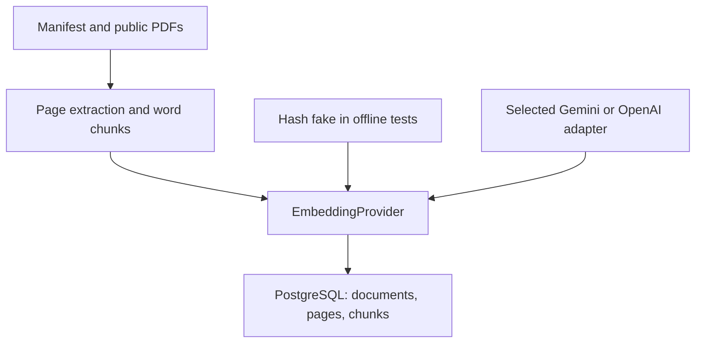

# CiteRAG

A staged RAG application for answers with verifiable document, page, and quote
citations. **Current milestone: M1 — skeleton and PDF ingestion.** Search,
answers, citation cards, and evaluation are not implemented yet.

## Start locally

Prerequisites: Git and Docker Compose v2. From a fresh checkout:

```bash
git clone https://github.com/garvj65/cite-rag.git
cd cite-rag
cp .env.example .env
docker compose up --build -d
```

While M1 is under review, first check out the milestone PR branch. Compose starts
PostgreSQL 16/pgvector, applies Alembic migrations, and starts the API at
<http://localhost:8000>. `/health` returns `{"status":"ok"}`; `/docs` shows the
current API. The health endpoint reports liveness, not database readiness.
Real providers are disabled by default.

The four commands start the **M1 skeleton**. The final five-command,
corpus-to-answer quickstart will be verified when M3 exists.

## Starter corpus: AI risk management

Two related public NIST PDFs keep the first corpus small and useful for an AI
engineering portfolio. Their overlapping terminology and different levels of
detail provide material for comparing keyword, vector, and hybrid retrieval.
The manifest records exact URLs, titles, and sources; PDFs are gitignored.

| Document | PDF pages | Source |
|---|---:|---|
| AI Risk Management Framework 1.0 | 48 | [NIST AI 100-1, January 2023](https://nvlpubs.nist.gov/nistpubs/ai/nist.ai.100-1.pdf) |
| Generative AI Risk Management Profile | 64 | [NIST AI 600-1, July 2024](https://nvlpubs.nist.gov/nistpubs/ai/NIST.AI.600-1.pdf) |

These are a versioned starter corpus, not a claim that they represent all current
AI guidance. Citations will use physical PDF pages rather than printed page
labels. The user will author the golden questions and gold answers.

With Python 3.12 and `uv` installed, from the repository root:

```bash
uv sync --frozen
uv run python scripts/download_corpus.py
```

The downloader validates YAML, bounds file size, checks the PDF signature, and
replaces files atomically. A cached file with a PDF header is reused; this does
not prove that the remote resource has not changed or that the complete cached
PDF is intact. Delete a file explicitly to fetch a newer copy. Ingestion performs
full parsing and identifies original PDF bytes by their content hash.

## Model budget

The original specification selected OpenAI. The user's subsequent preference
for free models changes the default configuration to **Gemini**, while retaining
the original `text-embedding-3-small` option behind the same provider interface.
There is no automatic fallback between providers.

The suggested configuration is `gemini-embedding-2` for embeddings and
`gemini-3.8-flash` for M3 answers. Google lists free API tiers for both as of
2026-10-24; quotas, regional/account eligibility, availability, and terms apply.
This is free-tier development, not unlimited production hosting. Use a project
on the free tier; the application cannot enforce your account's billing settings.
See [Google pricing](https://ai.google.dev/gemini-api/docs/pricing),
[rate limits](https://ai.google.dev/gemini-api/docs/rate-limits), and
[OpenAI compatibility](https://ai.google.dev/gemini-api/docs/openai). Free-tier
content may be used to improve Google's products; the selected corpus is public.

Put `GEMINI_API_KEY` in your local `.env` and explicitly set
`ENABLE_REAL_PROVIDERS=true` to ingest with real embeddings. Recreate the backend
container after changing its environment. Real-provider compatibility has mocked
contract coverage; no authenticated provider calls or model-quality measurements
have been performed. The chat model is only a documented M3 choice in M1.

```bash
docker compose run --rm backend python -m app.ingest --path corpus/
```

For an explicit ingestion smoke test with zero provider API calls:

```bash
docker compose run --rm backend python -m app.ingest --path corpus/ --fake
```

Fake embeddings are deterministic lexical hashes, not semantic embeddings or a
way to measure real retrieval quality. Profile hashes separate fake and real
embeddings. The CLI also works as
`uv run python -m app.ingest --path corpus/` against the local database.

Progress goes to stderr. Stdout contains a JSON summary with newly indexed
documents/pages/chunks, skipped and failed file counts, and reasons. Blank,
scanned/no-text, encrypted, corrupt, oversized, and excessive-page PDFs have
explicit skip reasons. Exit codes are 0 for a completed scan (including skips),
1 for processing/database failures, and 2 for invalid input/configuration.
Documents with some empty pages retain their original page numbering.

## Architecture and decisions



- Python 3.12, FastAPI, Pydantic v2, SQLAlchemy 2, Alembic, PostgreSQL 16, and
  pgvector. `uv.lock` pins dependencies.
- 400-word chunks with an 80-word overlap stay inside one page. Limits, timeouts,
  batch sizes, and retries are typed settings.
- SHA-256 identities and database constraints handle renamed duplicates and
  concurrent ingestion. Each document's write is atomic.
- Index profiles separate chunk configurations and embedding models. No queue,
  orchestration framework, OCR, or additional storage service is introduced.
- Transient provider failures retry with bounded exponential backoff. Permanent
  errors and invalid vector responses fail immediately; sensitive bodies are not
  printed. Retries are per batch. Persistent quota exhaustion requires waiting
  and rerunning the CLI.

See [architecture details](docs/architecture.md) for identities, offsets, and
transaction behavior. `AGENTS.md` contains the engineering rules.

## Checks

```bash
uv run ruff check .
uv run ruff format --check .
uv run mypy
uv run pytest
```

Tests block external sockets and mock provider HTTP. The five PostgreSQL
integration tests require a disposable local PostgreSQL 16 database with pgvector
available, named with a `_test` suffix. Set `TEST_DATABASE_URL` before pytest to
include them. They truncate application tables and exercise migration
downgrade/upgrade; never target a database with useful data. Without that
variable they are explicitly skipped. CI requires the database service and
enforces at least 85% backend application coverage.

GitHub Actions runs lint, formatting, strict application type-checking, tests
against PostgreSQL 16/pgvector, a backend image build, and Compose validation.
Frontend checks join CI when the frontend is implemented in M3.

M1 verification: **83 tests passed with PostgreSQL 16/pgvector; 99.62% backend
application coverage**. Lint, formatting, strict mypy, the backend Docker image
build, and Compose validation passed. See [the validation record](docs/validation-m1.md)
for the exact run and corpus extraction measurements. These are implementation
checks, not answer-quality evaluation results.

## Evaluation status

| Strategy | Recall@5 | MRR | Citation validity | Refusal accuracy | Latency p50/p95 |
|---|---|---|---|---|---|
| Vector | Pending M4 | Pending | Pending | Pending | Pending |
| Keyword | Pending M4 | Pending | Pending | Pending | Pending |
| Hybrid | Pending M4 | Pending | Pending | Pending | Pending |

No questions, gold answers, or measured retrieval results have been invented.
M4 requires user-authored golden data and an explicit real-provider run.

## Current limitations and next milestone

- M1 has no search, question answering, frontend UI, or evaluation harness.
  M2 follows review of this milestone.
- Extraction cannot OCR scans or reliably reconstruct complex tables,
  multi-column reading order, mathematical notation, or images.
- Word counts are not model token counts. A provider can reject unusually long
  chunks; the document remains unindexed rather than being truncated.
- Identical bytes retain the first source metadata. Updating extraction semantics
  requires a deliberate migration/reindex.
- Concurrent ingestions can consume duplicate embedding quota, although committed
  records are deduplicated. In-flight embeddings are not cached.
- The Compose password is a labeled local-development example. Deployment
  instructions and a real UI screenshot arrive with later application milestones.
  No production deployment is claimed.
