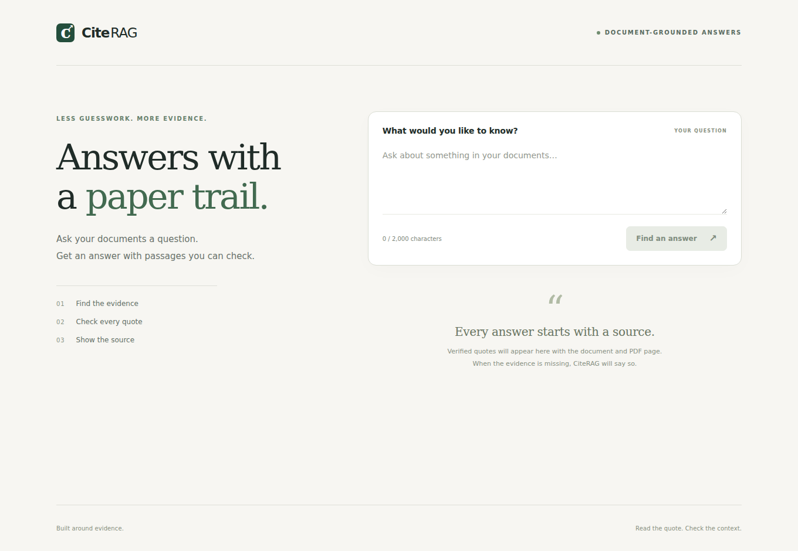
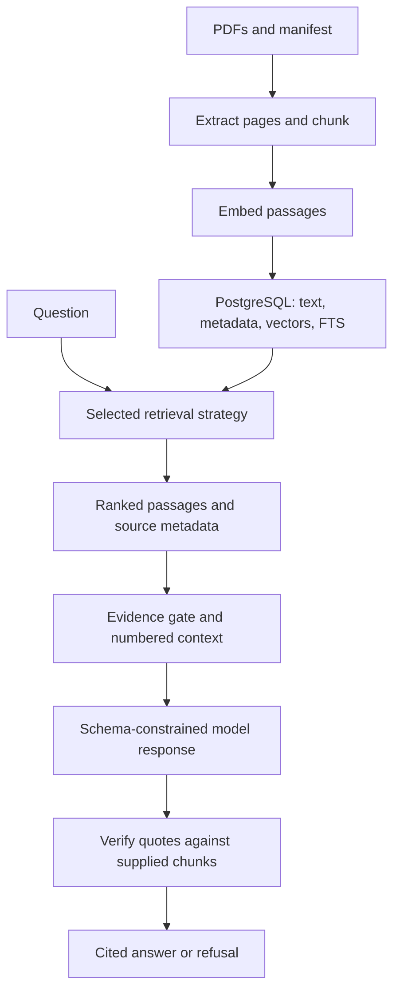

# CiteRAG

A staged RAG application for answers with verifiable document, page, and quote
citations. **M1–M3 are implemented:** PDF ingestion, three retrieval strategies,
evidence-gated answers, programmatically verified quote citations, and a React
interface. Golden-data evaluation remains M4 work.

[Learning guide](docs/learning-guide.md) · [Architecture](docs/architecture.md) ·
[M1 validation](docs/validation-m1.md) · [M2 validation](docs/validation-m2.md) ·
[M3 validation](docs/validation-m3.md)



## Start locally

Prerequisites: Git and Docker Compose v2. From a fresh checkout:

```bash
git clone https://github.com/garvj65/cite-rag.git
cd cite-rag
cp .env.example .env
docker compose up --build --wait frontend
```

While a milestone PR is under review, use its implementation branch. After
integration, `main` contains that milestone. Compose starts PostgreSQL 16 with
pgvector, applies Alembic migrations, and starts the UI at
<http://localhost:8080> and API at <http://localhost:8000>. Open the API’s `/docs`
for interactive `/search` and `/ask` requests.

The four commands start the UI, API, and database. Downloading and indexing the corpus
are explicit steps below. `/health` reports process liveness; Compose also
requires a healthy database and completed migrations. Real providers are disabled
by default. An empty matching index returns an empty results list.

## Download the starter corpus

Two related public NIST PDFs keep the corpus small. Their overlapping terminology
and different levels of detail provide material for retrieval comparisons. These
are fixed starter publications, not a claim to contain all current AI guidance.

| Document | PDF pages | Source |
|---|---:|---|
| AI Risk Management Framework 1.0 | 48 | [NIST AI 100-1, January 2023](https://nvlpubs.nist.gov/nistpubs/ai/nist.ai.100-1.pdf) |
| Generative AI Risk Management Profile | 64 | [NIST AI 600-1, July 2024](https://nvlpubs.nist.gov/nistpubs/ai/NIST.AI.600-1.pdf) |

After starting Compose, download using the existing image:

```bash
docker compose run --rm --user root --volume ./corpus:/app/corpus backend python scripts/download_corpus.py
```

The one-off downloader gets a writable bind mount. The API keeps its normal
non-root user and read-only corpus mount. Files downloaded this way can be owned
by root on Linux, but remain readable for ingestion. PDFs are gitignored.

Alternatively, with Python 3.12 and `uv` installed:

```bash
uv sync --frozen
uv run python scripts/download_corpus.py
```

The downloader validates YAML, bounds file size, checks the PDF signature, and
replaces files atomically. Cached files with a PDF header are reused. This does
not establish whether the remote resource changed or a cached PDF is complete;
delete a file explicitly to fetch it again. Ingestion parses the complete PDF
and identifies its original bytes by SHA-256.

## Configure and ingest

The default model configuration is **Gemini Embedding 2** for retrieval and
**Gemini 3.8 Flash** for M3 answers. The user's free-model preference updates the
original OpenAI-only specification. The original `text-embedding-3-small` option
remains selectable behind the same interface. No automatic provider fallback
exists, and no local model/GPU is required.

Google lists free API tiers for both suggested models as of 2026-10-24, subject
to quotas, account/region eligibility, availability, and terms. Use a free-tier
project; the application cannot enforce your account's billing configuration.
See [pricing](https://ai.google.dev/gemini-api/docs/pricing),
[rate limits](https://ai.google.dev/gemini-api/docs/rate-limits), and
[OpenAI compatibility](https://ai.google.dev/gemini-api/docs/openai). Free-tier
content may be used to improve Google's products; the selected PDFs are public.

For real embeddings and answers, edit the local `.env`:

```dotenv
EMBEDDING_PROVIDER=gemini
ENABLE_REAL_PROVIDERS=true
GEMINI_API_KEY=your-local-key
LLM_PROVIDER=gemini
```

For an explicit keyless mechanics demo, instead select:

```dotenv
EMBEDDING_PROVIDER=fake
LLM_PROVIDER=fake
ENABLE_REAL_PROVIDERS=false
```

Fake embeddings are deterministic lexical hashes. They support repeatable
mechanics tests and a keyless demo; they do not establish semantic retrieval
quality. There is no implicit switch into fake mode. Real-provider contracts
have mocked coverage, but authenticated model calls have not been verified yet.
The scripted LLM defaults to a fixed unsupported response. Tests/CI may supply
`FAKE_LLM_RESPONSE` with one predetermined JSON response; this is labeled as a
scripted demo in the UI and does not simulate semantic reasoning.

After editing `.env`, recreate the backend and ingest:

```bash
docker compose up --wait backend
docker compose exec backend python -m app.ingest --path corpus/
```

`--fake` remains available as a CLI-only override. To search its resulting index,
set the API's `EMBEDDING_PROVIDER=fake` too. Ingestion and the API must use the
same provider/model, chunk size, and overlap: the resulting profile hash keeps
incompatible embedding spaces and chunk experiments separate. Unchanged bytes
with unchanged settings are skipped, including renamed files.

Progress goes to stderr. Stdout contains JSON counts for newly indexed documents,
pages, chunks, skipped files, failures, and reason codes. Exit codes: 0 for a
completed scan including skips, 1 for processing/database failures, and 2 for
invalid input/configuration. Empty, corrupt, encrypted, scanned/no-text,
oversized, and excessive-page PDFs have explicit skip reasons. Empty pages inside
an otherwise extractable document retain their physical PDF page numbering.

## Search

Use `/docs` in a browser or send:

```bash
curl http://localhost:8000/search \
  -H 'Content-Type: application/json' \
  -d '{"query":"risk management","strategy":"hybrid","k":5}'
```

`query` is required. `strategy` and `k` default to environment settings.

| Strategy | Behavior | Response score type |
|---|---|---|
| `vector` | Exact cosine search in pgvector; one question embedding call | `cosine_similarity` |
| `keyword` | PostgreSQL English FTS via `websearch_to_tsquery` and `ts_rank_cd`; no embedding call | `fts_rank` |
| `hybrid` | Fuse vector and keyword candidate rankings using RRF | `rrf` |

The response includes `strategy`, requested `k`, `profile`, `score_type`, and
`results`. Each result contains `chunk_id`, `doc_id`, `document_title`, `source`,
`source_url`, one-based physical PDF `page`, zero-based per-page `chunk_index`,
exact stored `text`, and `score`. A page label printed in a document may differ
from the physical PDF page number. The `/search` endpoint returns passages directly; use `/ask` or the UI for
verified cited answers.

Scores order passages within their strategy. Their scales differ and are not
confidence probabilities. Vector retrieval can return weakly related passages;
M3 applies separate answer-support and citation gates. All strategies isolate the same
index profile and use deterministic tie-breaking.

An empty index returns HTTP 200 with `results: []`, without creating a provider
client. Keyword requests also make no provider call, including when real-provider
credentials are disabled after a corpus has already been indexed.

| HTTP status | Meaning |
|---|---|
| 422 | Invalid fields, empty/oversized query, unsupported strategy, or k outside configured limits |
| 502 | A model provider failed, returned invalid vectors, or returned malformed/truncated answer JSON |
| 503 | Database unavailable or a required model provider unconfigured |
| 504 | A model provider exhausted its timeout retries |

Errors use `{"error":{"code":"...","message":"..."}}` without raw provider
bodies, rejected payloads, credentials, SQL, or stack traces. Vector/hybrid
requests do not silently fall back to keyword search on provider failure.

## Cited answers and the interface

Open <http://localhost:8080> to ask a question, read an answer, and expand citation
cards containing the document, physical PDF page, and exact verified quote.
Loading, API failure, and evidence-refusal states are separate. Editing the
question clears the previous answer. Quotes/answers render as text, and source
links allow only HTTP(S). Provider credentials stay on the server.

The UI calls `POST /ask` through the same-origin `/api` proxy. Direct API requests
accept the same `query`, optional `strategy`, and optional `k` as `/search`.
An `/ask` keyword request makes no embedding call, but still needs a chat provider
when sufficient evidence is retrieved.

Generation follows these gates:

1. Empty results or passages below the selected strategy's score threshold
   return a fixed refusal without creating a chat client.
2. Whole eligible passages become a numbered JSON context within a character
   budget. Document text remains untrusted data, separate from system instructions.
3. The model must return strict JSON containing only `answer`, `citations`
   (`doc_id`, `page`, `quote`), and `supported`. Wrong types, unknown/duplicate keys,
   excessive output, and incomplete provider responses fail with HTTP 502.
4. Every quote must appear within **one of the exact supplied chunks** on the
   stated document/page, after whitespace normalization. Matching stays sensitive
   to case and punctuation; quotes cannot combine fragments from different chunks.
5. If any citation fails, or citations are missing, the entire answer is withheld.
   `supported=false` also returns a refusal. Document titles, source URLs, and chunk
   metadata always come from stored records, not model-generated metadata.

Evidence refusals return HTTP 200, `supported=false`, a fixed explanatory answer,
and no citations. They differ from model/database outages and malformed output,
which return error statuses. Successful `/ask` responses also include `reason`,
`mode` (`model`, `scripted`, or `no_model`), and `verification.proposed/valid` counts
computed **before** refusal filtering or citation deduplication.

**Quote matching proves provenance, not entailment of every answer claim.** The
prompt's grounding/injection instructions and scripted attack tests do not prove
real-model immunity to prompt injection. Semantic faithfulness, refusal accuracy,
and adversarial model behavior still require M4 evaluation on user-authored data.

The strategy-specific evidence defaults are cosine similarity **0.35**, keyword
rank **0.05**, and RRF **0.02**. These are **provisional, uncalibrated gates**, not
confidence probabilities. RRF-only gates depend on the fusion settings; changing
`RRF_CONSTANT` requires reviewing the hybrid gate. The context budget is 24,000
serialized characters; output limits are 12,000 answer characters, 8 proposed
citations, and 2,000 characters per quote. All limits are typed settings in
`.env.example`. Context uses whole chunks without silently truncating evidence.

## Configuration and design

Settings are typed in `backend/app/settings.py`; `.env.example` documents them.

| Setting | Default | Meaning |
|---|---:|---|
| `CHUNK_SIZE_WORDS` | 400 | Maximum words per within-page chunk |
| `CHUNK_OVERLAP_WORDS` | 80 | Shared words between consecutive windows |
| `EMBEDDING_BATCH_SIZE` | 16 | Number of passages sent per embedding batch |
| `SEARCH_STRATEGY` | hybrid | Default search strategy |
| `SEARCH_K` | 5 | Default result count |
| `SEARCH_MAX_K` | 50 | Maximum request result count |
| `MAX_QUERY_CHARACTERS` | 2000 | Maximum normalized query length |
| `HYBRID_CANDIDATE_K` | 20 | Candidate depth per source, increased to k when necessary |
| `RRF_CONSTANT` | 60 | Denominator offset for one-based fusion ranks |

Provider timeouts, bounded exponential-backoff retries, and PDF size/page limits
are configurable too. Permanent provider errors and invalid responses fail
without retrying. Persistent quota exhaustion requires waiting before retrying
the CLI. No API keys or full document text are logged at INFO.



- Python 3.12, FastAPI, Pydantic v2, SQLAlchemy 2, Alembic, PostgreSQL 16, and
  pgvector. `uv.lock` pins dependencies.
- Page-limited word windows preserve exact offsets into canonical normalized
  text. Word counts are not model-token budgets.
- SHA-256 identities and database constraints handle duplicates. A document's
  pages and chunks commit atomically after embedding succeeds.
- FTS migration 0002 populates existing M1 chunks automatically. Vector search
  remains exact for a clear correctness baseline.
- Hybrid RRF sums `1 / (constant + rank)` rather than adding incompatible raw
  scores. Each chunk contributes at most once per source ranking.
- No orchestration framework, queue, OCR, or extra storage service is introduced.

## Verification

```bash
uv run ruff check .
uv run ruff format --check .
uv run mypy
uv run pytest
```

Tests block external Python sockets and mock provider HTTP. Integration tests
require `TEST_DATABASE_URL` pointing to a local PostgreSQL 16/pgvector database
whose name ends in `_test`. They truncate application tables and test migration
changes; never point them at useful data. Without that variable the database
tests are explicitly skipped. CI always supplies the database service.

CI enforces at least 85% backend application coverage and runs lint, formatting,
strict application/script typing, and tests against PostgreSQL. Frontend checks
include ESLint, strict TypeScript, Vitest/React Testing Library, a production
build, and Playwright browser tests. CI builds both Docker images and starts the
actual Compose stack: it ingests an offline PDF twice, exercises all three search
strategies, and checks verified answers/refusals through the frontend API proxy.
These checks use explicit fake providers and make no authenticated model calls.

M3 verification: **207 backend tests passed, including all 19 PostgreSQL integration
tests, with 99.71% backend application coverage**. All **22 frontend tests** and
**3 browser tests** passed, along with lint, formatting, typing, production builds,
and the complete Compose ingestion/search/answer smoke check.
See [the M3 validation record](docs/validation-m3.md) for the exact commit, CI run,
behaviors checked, and measurement boundaries. Frontend checks can also run with
`npm ci`, `npm run lint`, `npm run typecheck`, `npm test`, and `npm run build` from
`frontend/`; its README documents the browser-test setup.

## Evaluation status

| Strategy | Recall@5 | MRR | Citation validity | Refusal accuracy | Latency p50/p95 |
|---|---|---|---|---|---|
| Vector | Pending M4 | Pending | Pending | Pending | Pending |
| Keyword | Pending M4 | Pending | Pending | Pending | Pending |
| Hybrid | Pending M4 | Pending | Pending | Pending | Pending |

No questions, gold answers, or retrieval-quality numbers have been invented.
The user writes the golden data in M4; model-quality evaluation needs an explicit
real-provider run. Mechanical ranking tests and code coverage are not semantic
retrieval or answer-quality measurements.

## Limitations and next milestone

- M1–M3 return retrieved passages and evidence-gated cited answers through the
  API and UI. The evaluation harness is M4 work.
- Extraction cannot OCR scans or reliably reconstruct tables, multi-column
  layouts, equations, or images. Page boundaries can divide useful context.
- English full-text search is appropriate for this corpus; other languages need
  a deliberate search configuration change.
- Very long chunks can exceed a provider's token limit. They fail without silently
  truncating evidence. Exact vector search trades scalability for a simple baseline.
- Identical PDF bytes retain first-ingestion source metadata. Changes to extraction
  semantics need a deliberate migration/reindex procedure.
- Concurrent ingestions can consume duplicate embedding quota while database rows
  remain deduplicated. In-flight embeddings are not cached.
- The Compose password is a labeled local-development example. Deployment
  instructions and a public-demo operating model arrive in M4. No production deployment is claimed.
