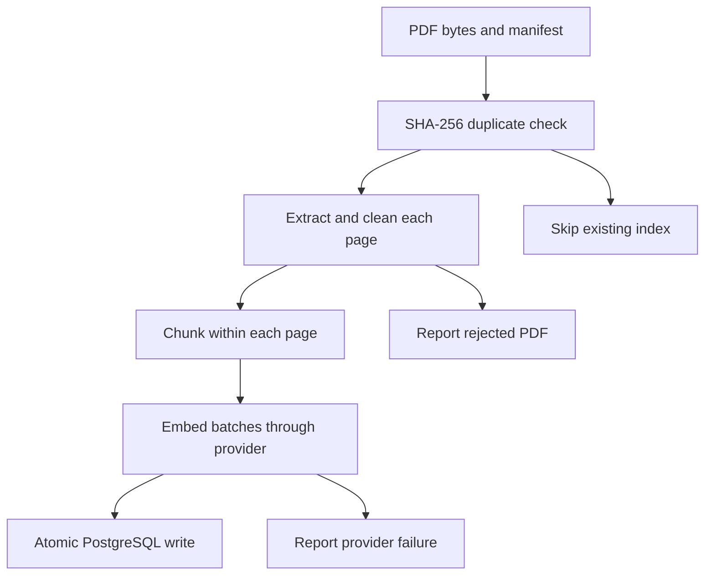

# M1–M3 architecture

The CLI coordinates manifest metadata, page extraction, word-window chunking,
an embedding provider, and a PostgreSQL repository.

`documents.id` is the full SHA-256 of the PDF bytes. `pages` uses `(doc_id,
page_number)` as its key. `chunks` adds a profile hash and a zero-based chunk
index within the page. Page numbers are one-based physical PDF pages, including
cover and contents pages. Empty pages remain in `pages` without producing chunks.

The profile hashes the pipeline version, chunk size/overlap in **words**, provider
model identity, and embedding dimensions. Word windows keep M1 deterministic
without a tokenizer vocabulary download in tests. They do not provide an exact
model-token budget. Character offsets refer to canonical whitespace-normalized
page text; cleaning never rewrites words.

All embeddings are requested at 1536 dimensions. Fake embeddings use a separate
model identity and a different profile from semantic embeddings. Future retrieval
must filter by one profile and use its exact provider/model.

Embedding happens before opening the write transaction. Documents, pages, and
chunks commit together. PostgreSQL uniqueness constraints make identical
concurrent writes safe; both workers may consume embedding quota before one is
recognized as a duplicate. There is no distributed lock or background queue.

The first successful ingestion owns document source metadata. Reingesting the
same bytes under another filename does not replace it. Changed PDF bytes are
a new document. Chunk-size experiments create new profiles while sharing the
same canonical pages. Changing extraction/cleaning semantics needs a deliberate
migration/reindex procedure; it is not silently handled in M1.

## Retrieval in M2

`POST /search` validates a query, strategy, and result count, then selects a
retriever through the shared `Retriever.search(query, k)` contract:

- Vector search embeds the question once and orders the matching profile's
  chunks by exact cosine distance in pgvector. It returns cosine similarity.
- Keyword search uses a stored generated `tsvector` with a GIN index. Both
  ingestion and querying explicitly use the English configuration. Queries go
  through `websearch_to_tsquery` and results use `ts_rank_cd`. Adding migration
  0002 also populates FTS vectors for existing M1 chunks.
- Hybrid search obtains `max(k, HYBRID_CANDIDATE_K)` candidates from each source
  and applies `sum(1 / (RRF_CONSTANT + rank))`, with one-based ranks. Missing
  candidates contribute zero. A chunk contributes at most once per source.

All strategies restrict results to the same profile hash. Ties use document ID,
physical page, chunk index, then database chunk ID. Raw vector and keyword scores
are never added together. Response `score_type` describes the returned score;
none of these scores is an answer-support probability.

The service checks whether the profile exists before creating a provider. Empty
profiles return an empty list, and keyword search never constructs a provider.
Vector and hybrid requests fail explicitly on provider errors; there is no hidden
switch to keyword retrieval or another model. Fake mode must be explicitly
selected through `EMBEDDING_PROVIDER=fake` (or `--fake` for the ingestion CLI).

Database engines belong to the application lifespan. HTTP embedding clients are
created lazily and closed after each request. Synchronous search handlers run
through FastAPI's thread-pool handling. Errors do not include request bodies,
provider responses, credentials, or SQL statements.

## Evidence-gated answers in M3

`POST /ask` reuses search's query/strategy/k validation. It filters retrieved
passages using independent strategy-specific thresholds. Empty/weak retrieval
returns a fixed refusal before creating a chat provider. Thresholds are provisional
defaults; they are not calibrated probabilities and need M4 validation.

Whole eligible passages are numbered and serialized as JSON data, within a
character budget including JSON escaping and the question. The system policy is
separate and versioned in `answering/prompts/system.txt`. Instructions embedded in
documents remain data. Only the exact included chunks can validate citations.

The LLM returns strict `{answer, citations:[{doc_id,page,quote}], supported}` JSON.
Pydantic rejects coercions/extra fields; parsing also rejects duplicate JSON keys
and configured output-size violations. Provider truncation or malformed output
is an HTTP error, distinct from an evidence refusal.

Each quote must match within one included chunk on the stated document and page,
after whitespace normalization only. Titles, URLs, and chunk IDs come from stored
metadata. If any citation fails, all answer text and citations are withheld.
`supported=false` and missing citations also produce a refusal. Proposed/valid
counts are preserved before filtering/deduplication so later evaluation cannot
inflate citation validity by measuring only released citations.

Quote verification proves provenance, not semantic entailment of every claim.
Prompt isolation and scripted attack fixtures do not prove real-model immunity
to prompt injection. Real faithfulness/adversarial evaluation remains M4 work.

The React interface sends same-origin `/api/ask` requests. nginx proxies them to
FastAPI and refreshes Docker DNS after backend recreation. Model credentials
stay on the server. The UI checks the response contract, renders text without
HTML interpretation, validates source-link protocols, and distinguishes evidence
refusals from request/provider errors. Explicit fake generation is labeled as a
scripted demo; it is never selected as an automatic provider fallback.

M4 adds user-authored golden data and measured retrieval/answer evaluation.
