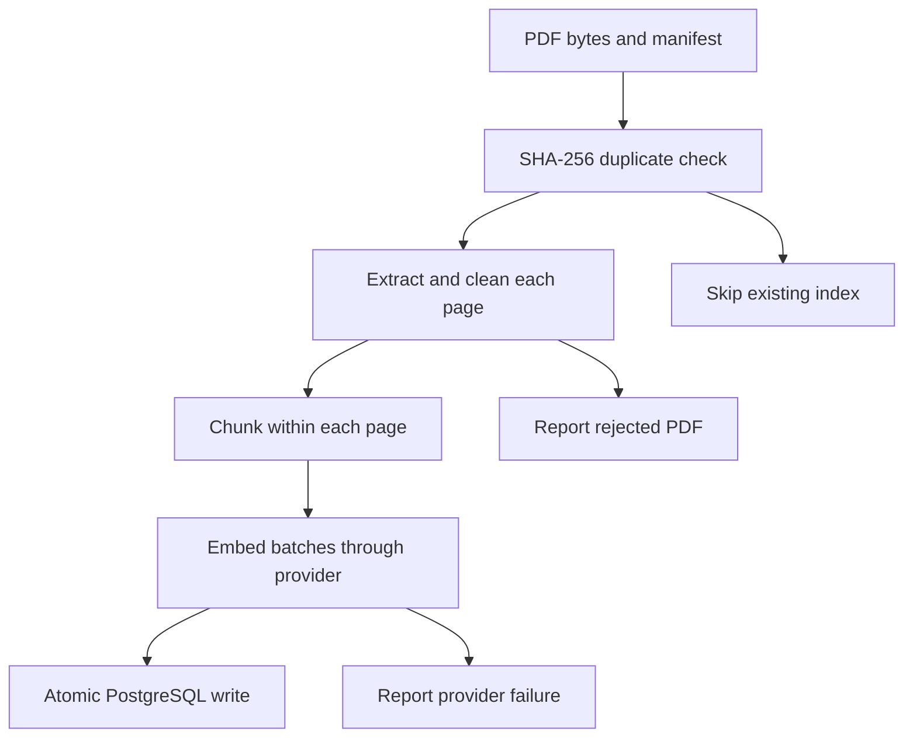

# M1 architecture

The CLI coordinates manifest metadata, page extraction, word-window chunking,
an embedding provider, and a PostgreSQL repository.

`documents.id` is the full SHA-256 of the PDF bytes. `pages` uses `(doc_id,
page_number)` as its key. `chunks` adds a profile hash and a zero-based chunk
index within the page. Page numbers are one-based physical PDF pages, including
cover and contents pages. Empty pages remain in `pages` without producing chunks.

The profile hashes the pipeline version, chunk size/overlap in **words**, provider
model identity, and embedding dimensions. Word windows keep M1 deterministic
without a tokenizer vocabulary download in tests. They do not provide an exact
model-token budget. Character offsets refer to canonical whitespace-normalized
page text; cleaning never rewrites words.

All embeddings are requested at 1536 dimensions. Fake embeddings use a separate
model identity and a different profile from semantic embeddings. Future retrieval
must filter by one profile and use its exact provider/model.

Embedding happens before opening the write transaction. Documents, pages, and
chunks commit together. PostgreSQL uniqueness constraints make identical
concurrent writes safe; both workers may consume embedding quota before one is
recognized as a duplicate. There is no distributed lock or background queue.

The first successful ingestion owns document source metadata. Reingesting the
same bytes under another filename does not replace it. Changed PDF bytes are
a new document. Chunk-size experiments create new profiles while sharing the
same canonical pages. Changing extraction/cleaning semantics needs a deliberate
migration/reindex procedure; it is not silently handled in M1.

M2 adds retrieval and FTS. M3 adds answer generation and citation validation.
M4 adds the user-authored golden corpus and measured evaluation. Those paths
are not implemented by the current health endpoint.
