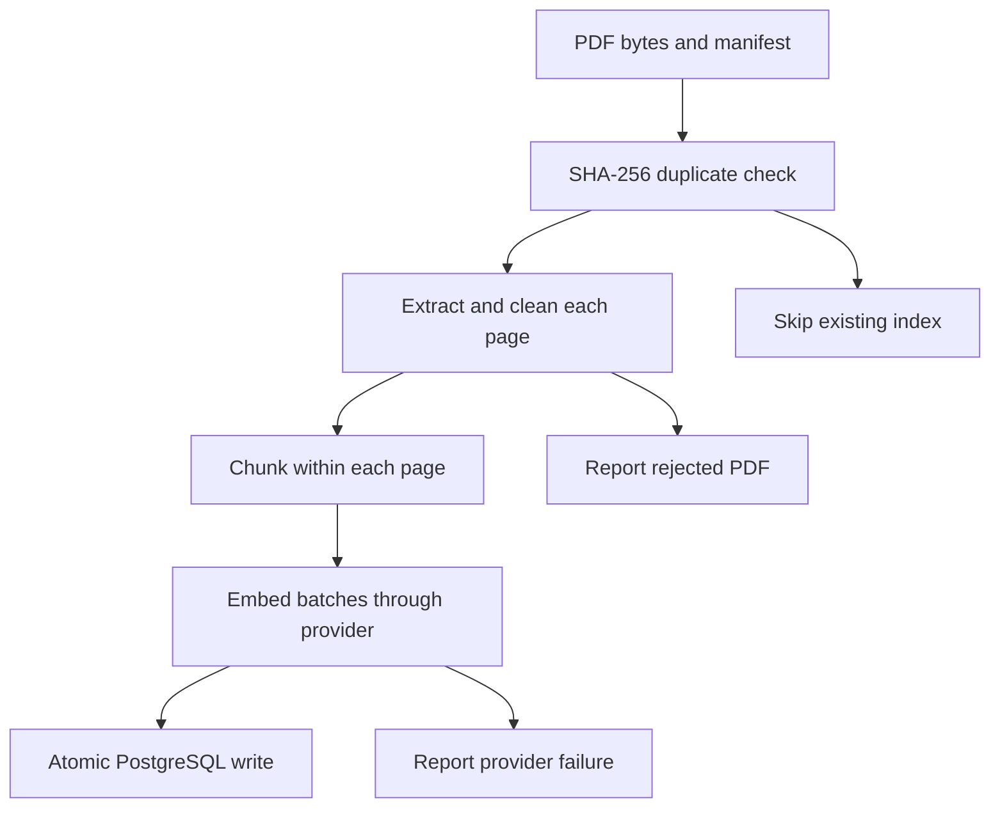

# M1–M4 architecture

The CLI coordinates manifest metadata, page extraction, word-window chunking,
an embedding provider, and a PostgreSQL repository.

`documents.id` is the full SHA-256 of the PDF bytes. `pages` uses `(doc_id,
page_number)` as its key. `chunks` adds a profile hash and a zero-based chunk
index within the page. Page numbers are one-based physical PDF pages, including
cover and contents pages. Empty pages remain in `pages` without producing chunks.

The profile hashes the pipeline version, chunk size/overlap in **words**, provider
model identity, and embedding dimensions. Word windows keep M1 deterministic
without a tokenizer vocabulary download in tests. They do not provide an exact
model-token budget. Character offsets refer to canonical whitespace-normalized
page text; cleaning never rewrites words.

All embeddings are requested at 1536 dimensions. Gemini uses its native synchronous
batch embedding endpoint with one content/request per chunk; response order and
count preserve the input mapping. Gemini chat uses native `generateContent` with
separate system instructions and a schema-constrained JSON response. Only complete
text output is accepted; thought parts are excluded and provider blocks are errors.
OpenAI retains its own endpoint. Fake embeddings use a separate
model identity and a different profile from semantic embeddings. Future retrieval
must filter by one profile and use its exact provider/model.

Embedding happens before opening the write transaction. Documents, pages, and
chunks commit together. PostgreSQL uniqueness constraints make identical
concurrent writes safe; both workers may consume embedding quota before one is
recognized as a duplicate. There is no distributed lock or background queue.

The first successful ingestion owns document source metadata. Reingesting the
same bytes under another filename does not replace it. Changed PDF bytes are
a new document. Chunk-size experiments create new profiles while sharing the
same canonical pages. Changing extraction/cleaning semantics needs a deliberate
migration/reindex procedure; it is not silently handled in M1.

## Retrieval in M2

`POST /search` validates a query, strategy, and result count, then selects a
retriever through the shared `Retriever.search(query, k)` contract:

- Vector search embeds the question once and orders the matching profile's
  chunks by exact cosine distance in pgvector. It returns cosine similarity.
- Keyword search uses a stored generated `tsvector` with a GIN index. Both
  ingestion and querying explicitly use the English configuration. Queries go
  through `websearch_to_tsquery` and results use `ts_rank_cd`. Adding migration
  0002 also populates FTS vectors for existing M1 chunks.
- Hybrid search obtains `max(k, HYBRID_CANDIDATE_K)` candidates from each source
  and applies `sum(1 / (RRF_CONSTANT + rank))`, with one-based ranks. Missing
  candidates contribute zero. A chunk contributes at most once per source.

All strategies restrict results to the same profile hash. Ties use document ID,
physical page, chunk index, then database chunk ID. Raw vector and keyword scores
are never added together. Response `score_type` describes the returned score;
none of these scores is an answer-support probability.

The service checks whether the profile exists before creating a provider. Empty
profiles return an empty list, and keyword search never constructs a provider.
Vector and hybrid requests fail explicitly on provider errors; there is no hidden
switch to keyword retrieval or another model. Fake mode must be explicitly
selected through `EMBEDDING_PROVIDER=fake` (or `--fake` for the ingestion CLI).

Database engines belong to the application lifespan. HTTP provider clients are
created lazily in worker-owned context managers. Async API handlers run the
synchronous service operation in a worker with an API response deadline. The
worker retains its clients until its operation finishes, including after a
timed-out caller receives 504. Remaining provider timeouts/backoff respect the
API budget; CLI/evaluation calls keep their configured retry budgets. Errors do not include request bodies,
provider responses, credentials, or SQL statements.

## Evidence-gated answers in M3

`POST /ask` reuses search's query/strategy/k validation. It filters retrieved
passages using cosine/keyword thresholds. Hybrid retains both component scores
and admits a chunk if either passes; its RRF score determines order only. Empty/weak retrieval
returns a fixed refusal before creating a chat provider. Thresholds are provisional
defaults; they are not calibrated probabilities and need M4 validation.

Whole eligible passages are numbered and serialized as JSON data, within a
character budget including JSON escaping and the question. The system policy is
separate and versioned in `answering/prompts/system.txt`. Instructions embedded in
documents remain data. Only the exact included chunks can validate citations.

The LLM returns strict `{answer, citations:[{doc_id,page,quote}], supported}` JSON.
Pydantic rejects coercions/extra fields; parsing also rejects duplicate JSON keys
and configured output-size violations. Provider truncation or malformed output
is an HTTP error, distinct from an evidence refusal.

Each quote must match within one included chunk on the stated document and page,
after whitespace normalization only. Titles, URLs, and chunk IDs come from stored
metadata. If any citation fails, all answer text and citations are withheld.
`supported=false` and missing citations also produce a refusal. Proposed/valid
counts are preserved before filtering/deduplication so later evaluation cannot
inflate citation validity by measuring only released citations.

Quote verification proves provenance, not semantic entailment of every claim.
Prompt isolation and scripted attack fixtures do not prove real-model immunity
to prompt injection. Real faithfulness/adversarial evaluation remains M4 work.

The React research workspace loads backend-owned limits/defaults from
`/api/config`, then sends the chosen strategy/k with same-origin `/api/ask` requests.
Configuration failure blocks submission; editing inputs clears stale results.
The API owns query validation. The UI counts Unicode code points to match it. nginx proxies them to
FastAPI and refreshes Docker DNS after backend recreation. Model credentials
stay on the server. The UI checks the response contract, renders text without
HTML interpretation, validates source-link protocols, and distinguishes evidence
refusals from request/provider errors. Explicit fake generation is labeled as a
scripted demo; it is never selected as an automatic provider fallback.

## Evaluation in M4

Golden JSONL labels are source-grounded; `eval.validate` checks the field schema, unique
identities/questions, answerability/page consistency, and query bounds. Optional
database validation checks that every gold page exists in the active index.
Empty data cannot produce a benchmark report.

`eval.run` wires the same `SearchService` and `AnswerService` used by the API.
Each question retrieves once. `answer_from_retrieval` generates from exactly that
measured result, avoiding a second embedding/search call. Provider clients are
lazy, shared within one sequential evaluation, and closed afterward; scripted
providers reset per question. A seeded shuffle fixes order, not live model output.

Recall deduplicates gold pages among the first k chunks; MRR uses the first
matching chunk rank. Citation validity uses raw proposed/valid counts before
refusal filtering/deduplication. Failures remain rows, contribute zero where
appropriate, and cannot become correct refusals. Undefined denominators are N/A.
Latency includes retries, validation, and failed attempts, excluding optional
intentional pauses between questions. No LLM judge is used.

Reports save safe settings, corpus IDs, gold-file digest, index profile, seed,
revision/dirty state, and raw per-question records. Credentials/database URLs are
excluded. The comparison script checks the same document IDs across chunk profiles
and uses explicit opt-in for ingestion. Experiments require a quiescent database.

The harness and an assistant-authored 30-question baseline are implemented.
Real retrieval and end-to-end attempts are [measured](../eval/results/20261026_gemini_baseline.md),
with provider failures and refusal gaps retained. Independent human label review
and held-out validation remain pending. Vector is the default strategy; the
hybrid evidence gate uses the same provisional, uncalibrated component thresholds.
See [the benchmark provenance and evidence](../eval/golden-review.md). A manually
dispatched GitHub workflow supports the real run using an Actions secret and disposable database; normal CI uses fakes.
See the [browser evaluation handoff](evaluation-handoff.md).
