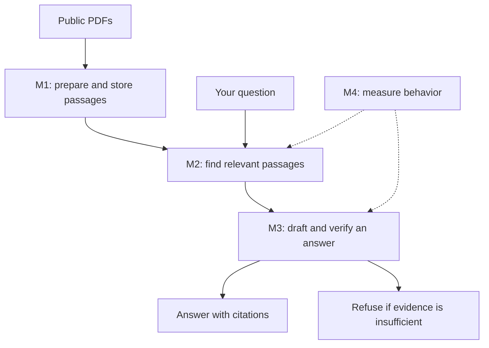

# Learn RAG by building CiteRAG

Start here if RAG is new to you. Your current laptop does not need to run the
whole application for you to follow the data, read the code, and predict what
the tests should do. Browser-hosted compute is an option for later hands-on work.

Current state: **M1 ingestion is integrated, and M2 implements `/search` with
vector, keyword, and hybrid retrieval. Answers, the frontend, and evaluation
are planned for M3–M4.**
The user has accepted the NIST AI risk corpus and Gemini provider configuration.

## 1. What RAG means

Imagine answering an open-book question. You find a relevant page, read the
passage, and write an answer with its source. RAG applies that process to an LLM:

- **Retrieval:** find useful passages in a collection of documents.
- **Augmentation:** put those passages beside the user's question in the model's input.
- **Generation:** ask the model to write an answer using that evidence.

Our collection is called the **corpus**. It currently contains two public NIST
PDFs. Preparing those PDFs for lookup is called **ingestion**.

We are not training or fine-tuning Gemini on the PDFs. At answer time, the model
will receive selected passages as input. That does not update its model weights.

RAG can still fail: search can select the wrong passage, or a model can make an
unsupported claim. CiteRAG therefore includes citation checks, refusals, and
evaluation as explicit application behavior.

## 2. What M1 does, step by step

1. **Download:** read the manifest, then fetch the selected PDFs.
2. **Identify:** calculate a SHA-256 hash of the original file bytes. The same
   file renamed has the same identity, which lets us recognize duplicates.
3. **Extract:** read text separately from every PDF page. Keep the physical page
   number, including cover and contents pages.
4. **Clean:** normalize whitespace so line breaks and repeated spaces are consistent.
5. **Chunk:** split each page into smaller overlapping passages.
6. **Embed:** ask the selected embedding provider for one numerical vector per chunk.
7. **Store:** save the document, pages, passage text, offsets, and vectors in PostgreSQL.

A **chunk** is a short passage we can retrieve and give to the answering model.
Our current windows contain up to 400 words, with an 80-word overlap. Overlap
helps preserve nearby context at a cut. It also repeats some text and increases
storage and embedding work. We will compare sizes during M4.

Chunks never cross a page boundary. A short page produces a short chunk. An empty
page keeps its page number but produces no chunk. This makes later page citations
traceable, at the cost of sometimes splitting context across two pages.

An **offset** is a character position in the stored page text. Keeping start and
end offsets lets us check exactly which part of the canonical page became a chunk.

An **atomic write** means all of a document's database changes commit together.
If an embedding batch fails, we do not save half a searchable document.

## 3. Embedding model, answering model, and database

| Component | Job in CiteRAG | What to understand first |
|---|---|---|
| Gemini Embedding 2 | Convert passages, and later questions, into vectors | A vector is a list of numbers used for similarity comparisons |
| Gemini 3.8 Flash | Write an answer using selected passages in M3 | It needs useful evidence and its output must be checked |
| PostgreSQL | Store documents, text, metadata, and vectors | A database stores and retrieves application records |
| pgvector | Add vector storage and similarity operations to PostgreSQL | It enables the numerical comparison used in vector search |

A real embedding model is designed so related text often has nearby vectors.
Similarity is a relevance signal, not proof that a passage answers a question.
The same embedding model and compatible configuration must be used on both sides
of a comparison. We must not mix fake and real embedding spaces.

We request 1536 numbers per vector. You do not need to memorize those numbers or
interpret individual coordinates to understand the pipeline.

**Important current distinction:** tests use a deterministic hash-based fake.
It lets us test batching, storage, failures, and ranking mechanics without an
external API. It does not simulate the semantic quality of Gemini. No
authenticated provider calls or model-quality evaluation have been performed.

## 4. What the next milestones add

| Milestone | Plain-language goal | Main concept |
|---|---|---|
| M1, implemented | Prepare a searchable collection with preserved sources | Ingestion and provenance |
| M2, implemented | Return relevant passages for a question | Keyword search, vector similarity, hybrid ranking |
| M3 | Write an answer and verify its quoted sources | Structured output, citation validation, refusal |
| M4 | Measure whether the application behaves well | Golden data, retrieval metrics, refusal tests, latency |

In M2, keyword search uses PostgreSQL's text-search processing. Vector search
compares a question's embedding with stored passage embeddings. Hybrid search
combines rankings from both. **Top-k** simply means the number of results returned.

In M3, a citation contains a document, page, and quoted passage. We will check that
each quote appears in a retrieved chunk on the stated page, after whitespace
normalization. A matching quote establishes where the words came from. It does
not by itself establish that every sentence in the answer follows from those words.

Refusal means the system cannot support an answer from the selected documents.
It is different from an API outage or an invalid model response, which must be
reported as an error. These are planned M3 behaviors, not existing M1 features.

In M4, the user writes the questions and gold document/page labels. The evaluation
runner compares actual outputs with that reference data. We will not invent gold
answers or claim fake-provider performance as real retrieval quality.

## 5. Read the existing code in this order

These links open actual project files. Read one or two files at a time.

| Order | File | Look for |
|---|---|---|
| 1 | [extract.py](../backend/app/ingestion/extract.py) | How PDF bytes become numbered pages |
| 2 | [chunk.py](../backend/app/ingestion/chunk.py) | How a page becomes overlapping passages |
| 3 | [test_chunk.py](../backend/tests/unit/test_chunk.py) | Concrete input/output examples and boundary cases |
| 4 | [interfaces.py](../backend/app/providers/interfaces.py) | The contract an embedding provider must satisfy |
| 5 | [fakes.py](../backend/app/providers/fakes.py) | How tests replace an external model |
| 6 | [service.py](../backend/app/ingestion/service.py) | How extraction, embedding, and storage connect |
| 7 | [models.py](../backend/app/db/models.py) | The document, page, and chunk records we store |

A **provider interface** is a contract: this part of our application asks for
embeddings without needing to know the vendor's HTTP details. A **fake** is a
small implementation that returns repeatable results for tests. This is why
changing providers does not require rewriting the chunker or ingestion service.

An automated **test** supplies an input, exercises behavior, and checks the result.
CI runs those checks on GitHub's machines after a push or PR update. A passing
test suite establishes the behavior it checks; it does not establish semantic
answer quality for questions it has not evaluated.

## 6. First exercise: trace a chunk without running anything

This is an invented word sequence for learning the chunker, not a golden
evaluation record or a claim from the NIST corpus.

Page 1 contains `alpha beta gamma delta epsilon`. Use a size of 3 words and an
overlap of 1 word. Before reading the result, work out where the second window starts.

Expected result:

| Chunk index | Page | Text |
|---|---:|---|
| 0 | 1 | `alpha beta gamma` |
| 1 | 1 | `gamma delta epsilon` |

The shared word is `gamma`. We move forward by `size - overlap`, or 2 words.
The last window already reaches the end, so the function stops there instead
of adding an unnecessary final window containing only `epsilon`.

Trace this against `chunk_pages` and the matching parameterized example in
`test_chunk.py`. Then change the overlap to 0 on paper and predict the two chunks.
Keep the page number unchanged. This small prediction is useful even without a terminal.

## 7. Use your browser while local setup is unavailable

For reading and editing, open the
[repository](https://github.com/garvj65/cite-rag)
and press the `.` key. GitHub opens a free browser editor with file navigation.
That editor has no terminal or execution environment.

For running code remotely, **GitHub Codespaces** provides a cloud machine with a
browser editor and terminal. Use the implementation branch while a PR is under
review, or `main` after integration. A default Codespace may need runtime/dependency
setup; this repository does not yet contain a tested Codespaces configuration.

Personal accounts have limited included monthly compute and storage. Check your
remaining quota and budget settings before creating one. Stop it after working;
retained storage also uses quota until you remove it. No Codespace is created by
this guide, and running the pure chunker does not require a provider API key.

References: [browser editor](https://docs.github.com/en/codespaces/the-githubdev-web-based-editor),
[Codespaces introduction](https://docs.github.com/en/codespaces/about-codespaces/what-are-codespaces),
[included usage and billing](https://docs.github.com/en/billing/concepts/product-billing/github-codespaces).

## 8. A short resource list, in learning order

These resources can be read or watched in a browser. Start with the first one
and our chunking exercise; the remaining readings can accompany the milestones.
Links were checked on 2026-10-24.

| When | Resource | Focus |
|---|---|---|
| Start here | [IBM: What is RAG?](https://www.ibm.com/think/videos/rag) | The retrieval-plus-generation idea in a visual explainer |
| Before M2 | [Google ML Crash Course: Embeddings](https://developers.google.com/machine-learning/crash-course/embeddings) | Why numerical representations can capture similarity; start with the conceptual explanation |
| As we expose endpoints | [FastAPI: First Steps](https://fastapi.tiangolo.com/tutorial/first-steps/) | A small Python function becoming an HTTP endpoint and interactive API documentation |
| Alongside our tests | [pytest: Get Started](https://docs.pytest.org/en/stable/getting-started.html) | Inputs, assertions, and what a failing test tells you |
| When reading our Docker files | [Docker: What is a container?](https://docs.docker.com/get-started/docker-concepts/the-basics/what-is-a-container/) | How application processes and dependencies are packaged consistently |

The Google module lists introductory ML prerequisites. You can first read the
similarity illustrations and return to the deeper training details later.

For each build milestone we will use the same teaching pattern: explain the
problem, trace a small example, read the relevant implementation, inspect a test,
and try one small prediction or change. We will introduce new tools when the
milestone needs them.

## 9. M2: understand retrieval after the build

Start with the working request in the README, then trace these files:

1. [search.py](../backend/app/api/search.py) receives and validates HTTP input.
2. [service.py](../backend/app/retrieval/service.py) applies configured limits
   and chooses a strategy.
3. [strategies.py](../backend/app/retrieval/strategies.py) implements vector,
   keyword, and hybrid search behind the same interface.
4. [repository.py](../backend/app/retrieval/repository.py) asks PostgreSQL for
   ranked chunks, filtering by the index profile.
5. [test_retrieval.py](../backend/tests/unit/test_retrieval.py) checks the RRF
   arithmetic with hand-computed examples. Integration tests exercise the real
   PostgreSQL queries with deterministic fake embeddings.

RRF rewards a passage that appears near the top of both lists. For example, with
constant 60, a passage ranked second in vector search and first in keyword search
scores `1/62 + 1/61`. A passage appearing only first in vector search scores
`1/61`. The raw keyword and vector scores do not need a common numeric scale.

A small reading exercise: find the test for keyword search's provider-call count.
Explain why the expected count is zero. Then read the empty-profile test and
explain why vector search also makes zero provider calls in that case.

For M2-specific resources, read PostgreSQL's
[text-search explanation](https://www.postgresql.org/docs/16/textsearch-controls.html)
and pgvector's [querying and distance examples](https://github.com/pgvector/pgvector#querying).
The priority remains finishing each working milestone; these readings can follow it.
